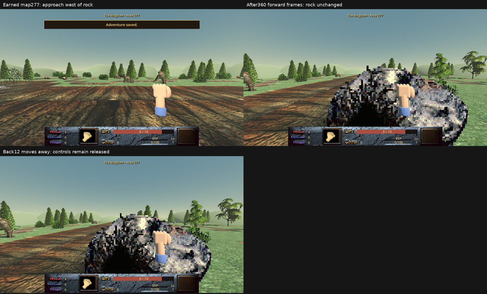
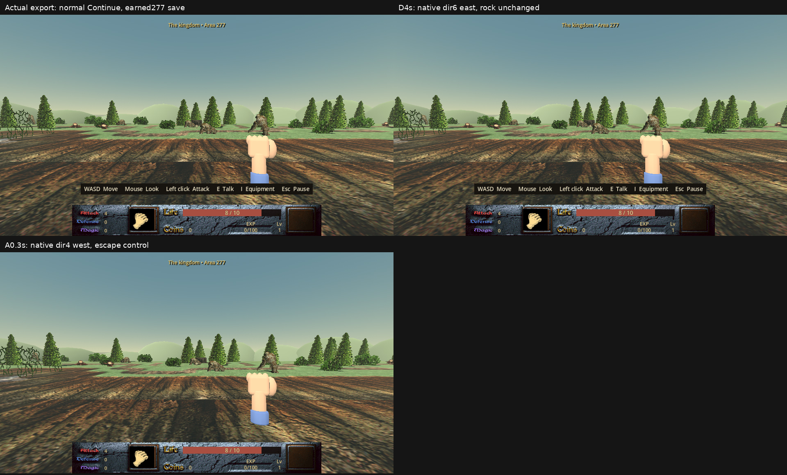
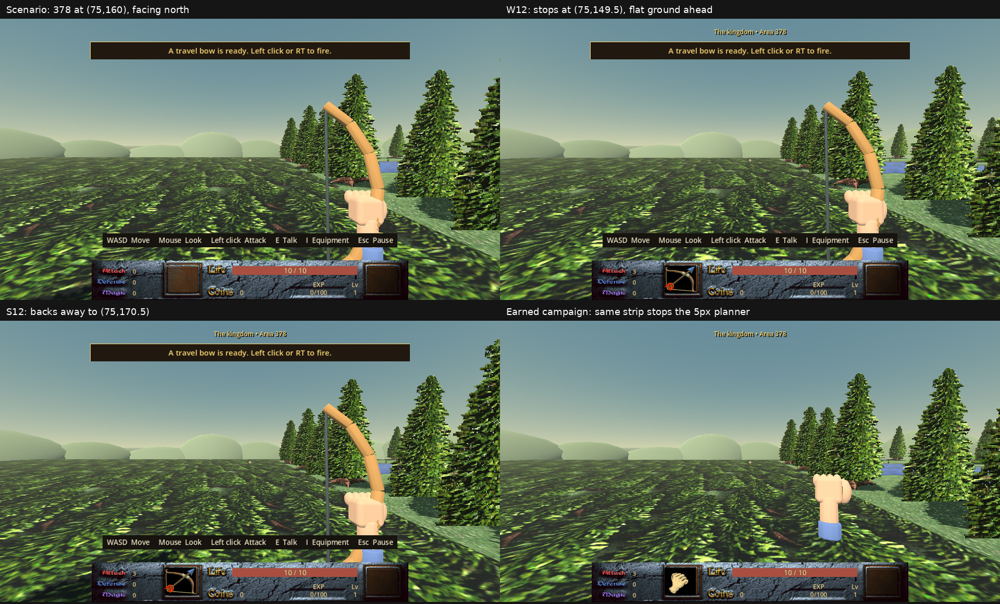
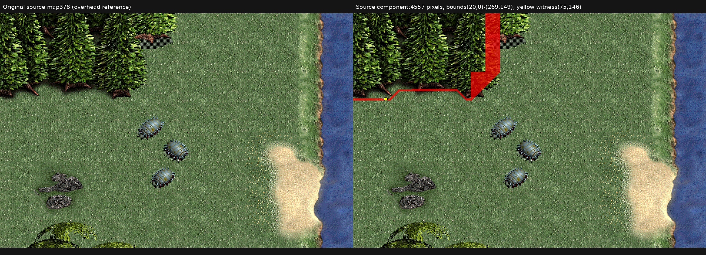
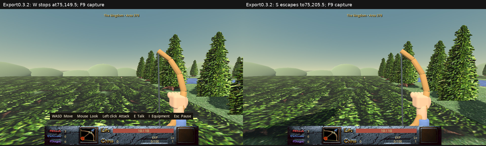
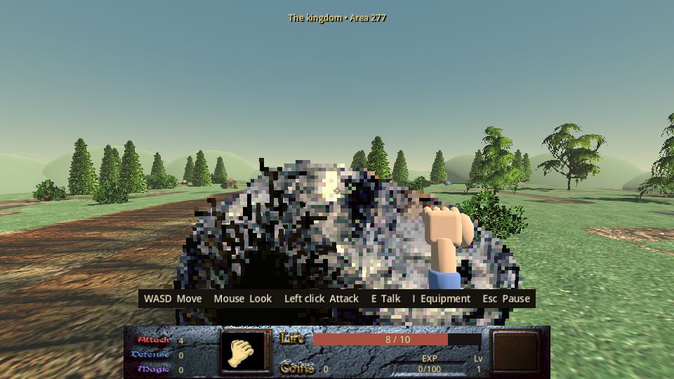
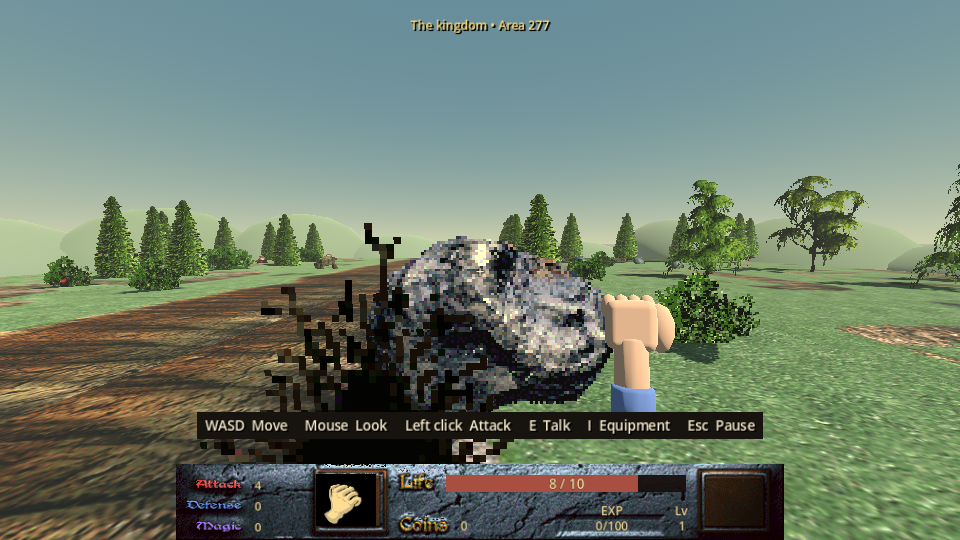

# Campaign route on 0.3.2 — 2026-10-19

The real-input route completed the opening, pig chores, Ethel/Quackers, AlkTree,
fire aftermath and Aunt Maria's letter. An unmodified earned save then reached
Martridge's cabin, accepted the Bonca quest and collected the strength potion.
The source and packed-resource runs initially stopped on map 341 because the
controller chose the wrong connected region for its next northward leg.
An explicit component detour then reached the cave rock on **map 277**.
Its ordinary push failed despite earned strength 4; the actual 0.3.2 Linux
executable reproduces the failure with native direction 6. Static evaluation
plus executable repro attributes the stop to the rock; no intervention control
was run. Missing PUSH dispatch and the contact margin are candidate mechanisms.
**Bonca and Terris were not reached.** This is a suspected game interaction
failure, not evidence that Dink is trapped.

No production game files changed. This unit restores the campaign harness from
`3fd67d1` onto `9e0a51f` and corrects its observation, steering and planning drift.
The map-378 witness is a reproduced instance of the existing forest art/mask
disagreement, with an escape control and an actual Linux-export reproduction.

## Build and method

Test date: 2026-10-19. Source base: `9e0a51f`, version 0.3.2. Godot:
4.6.1-stable official, Linux, GL Compatibility with software llvmpipe, 960×540
game viewport inside an isolated Xvfb display. The tested Linux executable's
SHA-256 is
`27f9b8e782eba15179de29790222f5366ec98349865dcde27afe63dea011ff43`.

Campaign sessions begin at the actual title screen, use Begin/Continue,
keyboard equipment selection, mouse look, movement, talk, attack and ordinary
dialogue/menu input. Native collision grids are read-only observations: their
query leaves player state and simulated frame count unchanged. Coordinates
below use the original 640×400 map space. The helper
`_walk_to_authored_door_trigger` uses ordinary movement to enter authored door
triggers and requires the expected destination; it does not
inject a transition.

Retained campaign runs use Dummy audio, isolated XDG data/config/cache,
`nice -n 10`, timeouts and the shared `dink-godot.lock`. Long runs were named
systemd user services. The player profile and installed game were untouched.
The deterministic controller does not seed the game's random number generator;
duck appearance and incidental damage can differ between runs.

The packed campaign uses the editor engine with `--main-pack` and the external
test bridge. It tests embedded game resources, not the exported executable's
startup/input loop. The separate focused tests launch that executable and use
operating-system movement/F9 input. The map-378 setup is explicitly a **scenario**:
campaign progression and map startup scripts are skipped, placing Dink on map
378 at (75,160), facing north. It saves normally before the executable loads
that isolated profile. This is not evidence of an earned exported campaign.
The map-277 executable test instead Continues the unmodified, earned pre-push
save from the real campaign continuation; no scenario setup is involved.

## Route evidence

The compact [checkpoint ledger](route-0.3.2/checkpoints.json) preserves failed
run outcomes and selected quest/control observations. The
[frame ledger](route-0.3.2/frames.json) binds the native captures to their hashes.
The committed [full title-to-letter input trace](route-0.3.2/source-4-title-letter.jsonl.gz)
contains every native protocol command and response from startup through the
earned letter save (10,193 records, 5,096 commands, 331,348 bytes compressed).
The [trace manifest](route-0.3.2/source-4-title-letter.json) records the range,
hashes, endpoint, command counts and sanitization: only the isolated session
path and screenshot-response paths change; every input command is unchanged.
All frame-ledger source paths now name committed original capture bytes, with
SHA-256 checks. Unsanitized later traces and isolated earned saves remain local
under `tmp/p1-route/`.

| Leg | Observed completion | Evidence |
| --- | --- | --- |
| Title → opening → pigs → home | Normal opening and feed collection; `pig_story=1`; mother acknowledges chores | [Opening sheet](route-0.3.2/01-opening.jpg) |
| Ethel → Quackers → Ethel → home | Duck returned alive; `old_womans_duck=4`; mother assigns nuts, `story=2` | [Ethel sheet](route-0.3.2/02-ethel.jpg) |
| AlkTree → Lyna/Milder → fire aftermath | Nut acquired through attack/touch scripts, `nuttree=2`, `story=5` | [AlkTree sheet](route-0.3.2/03-alktree.jpg) |
| Guard → home → letter/map | `story=6`, `letter=2`, `s2-map=1`; map opens, blocks movement and closes; controls and VM tasks released | [Letter sheet](route-0.3.2/04-letter.jpg) |
| Earned letter → cabin → Bonca request | Normal Continue, outdoor traversal and cabin entry; `wizard_see=2`, `strength=4`; normal save | [Wizard/road sheet](route-0.3.2/07-wizard-road.jpg) |
| Cabin → western cave road | Source and packed resources reach 341 at (34.752930,385.016785); initial route cannot reach north from that component | [Wizard/road sheet](route-0.3.2/07-wizard-road.jpg) |
| Component detour → cave rock | Ordinary crossings reach 277; strength 4, `wizard_see=2`; three forward120 holds leave rock unchanged; back12 escapes | [Cave-rock sheet](route-0.3.2/09-cave-rock.jpg) |
| Actual executable: cave-rock continuation | Normal Continue; D4s sets native direction 6 and stops west of the rock; A0.3s escapes; all F9 states retain `rock_placement=0` | [Exported rock sheet](route-0.3.2/10-export-rock.jpg) |

The uninterrupted title-to-letter prefix (`source-4`, 2,276 controller calls;
5,096 native protocol commands including observations) earned its letter save
at frame 19,666, map 439 (362.416656,303). The complete later-failing run has
2,478 controller calls; these are not all part of the published letter prefix.
Save SHA-256:
`df74d45f9dc7c62b7d35150c0f2a74ffa7df215483ff9c2785d2af3e3c6445ec`.
The requested Terris run still has `ok=false`: its later navigation failure is
not converted into a passing campaign result.

`source-7` (1,852 commands) and `packed` (1,850) normally Continue that save.
The loader checks position, map, inventory, magic inventory and relevant saved
globals against the earned checkpoint, with float32 canonicalization only for
serialized coordinates. Source failure/provenance remains visible. The earned
wizard-training save has SHA-256
`7c62c9387f48de4622a2e714077ebfab0a4938b79b08139dbc30c580d04962f7`.

## Route blockers and controls

| Finding | Position/input | Classification and result |
| --- | --- | --- |
| Inventory observation omitted pinned selection/footer | 439 (363.163269,311.918213), normal inventory navigation | Harness failure; bridge telemetry updated, later runs equip feed/fists normally |
| Pig approach tolerance permitted stopping outside feed box | 407 (195.585342,273.545532), waypoint (220,270) with radius 25 | Harness failure; radius 20 now implies membership in the script's feed box |
| Mouse turn overshot at scaled viewport | 409 near (268.5724,392.6345), then forward crossed south to 441 instead of reaching Ethel | Harness failure; measured closed-loop yaw and immediate wrong-map rejection |
| Rounded collision sample rejected a valid landing | 377 (28.946228,385.033264), rounded sample (30,385) blocked | Harness failure; real back for 12 frames crossed to 376 (607.946228,385.033264), so no trapped-player claim |
| Greedy map sequence enters wrong region | 341 (34.752930,385.016785), desired north to 309 | Harness failure; the route lacks component-aware knowledge. Both source and packed runs agree. No north exit from this region, but east/west exits exist |
| Cave-rock push fails | 277, source starts (225.000366,180.999481), three forward120 holds; actual export D4s stops (230.250366,180.287567), native direction 6 | Game failure (suspected). Candidates: missing PUSH dispatch and contact-margin mismatch (grow4 stop x230.25 versus original grow2 push-selection boundary x233). Static evaluation plus executable repro attributes the stop to the rock; no intervention control isolates the candidates. Strength4, rock (285,180)/flag0 unchanged; A/back escape succeeds |

The source-4 four-direction probe changes the final trace position after its
377 planning failure. The failed approach position above precedes that probe;
the final retained player position is on 376. The back control is real input,
not a restored Python position.

### Map 341 and component-guided continuation

The existing RC5 effective-source-mask census matches all 240,000 native map 341
samples. From reached region 14, north has no exit with raw masks or 1/2/3px
clearance; east and west each retain 20 sampled exits.
[Connectivity evidence](route-0.3.2/connectivity-341.json) therefore rejects a
clearance-regression explanation. The controller greedily chose the first
reachable edge without considering which region of the next screen it entered.
The development error was modeling route nodes as screens instead of connected
regions when later exits depend on entry. This does not establish a game bug.

Static outdoor connectivity gives 341/14 → 340/3 → 341/1 → 309/1 → 277/2, with no
injected warp, key, story or cave gate. The
[route knowledge](route-0.3.2/route-knowledge.json) and
[explicit leg targets](route-0.3.2/guided-legs.json) bind that evidence to the
existing census hash. `tools/playtest_cave_route.py` changes only the road's
targets, retaining the same planner and ordinary inputs. Static connectivity
alone is not live traversal certification.

The single guided attempt (`guided`, 1,283 commands) normally Continues the
earned strength-potion save. Its live verified arrivals are:

| Leg | Arrival (x,y) | Frame |
| --- | --- | ---: |
| 341/14 → 340/3 | (604.042358,346.090576) | 4,141 |
| 340/3 → 341/1 | (35.220459,70.009102) | 4,444 |
| 341/1 → 309/1 | (154.382095,384.004822) | 4,587 |
| 309/1 → 277/2 | (319.840210,384.002777) | 4,987 |

It saves normally west of the rock at (225.000366,180.999481), frame 5,166.
That unmodified save's SHA-256 is
`5d275b27c644cac8ed569e04533fbcfdc82bcee6a66a7ea381e27a8d5a57f7c3`.
The [exact selected input/state trace](route-0.3.2/rock-push-trace.json) records
all three forward120 commands and the back12 control, binding them to the
complete retained report's hash. At frames 5,288/5,409/5,530 the player is at
(230.249634,177.502167), (230.249634,187.071259), and
(230.249634,168.018372), respectively. Slightly non-cardinal aiming causes
sliding along the blocked edge. The rock stays (285,180), `rock_placement=0`,
`strength=4`, `wizard_see=2`; VM tasks remain 0, controls released. Back12 then
moves to (224.175049,170.708191), frame 5,542. The run retains `ok=false` and
`failure_class="game suspected"`.



### Cave rock: actual executable and collision ownership

`tools/repro_cave_rock.py` checks the retained save/report binding, copies the
save without editing, and uses normal title Continue in the actual Linux
executable. The saved camera faces north, yaw −6.281517627; OS D therefore
strafes east. F9 proves the native player direction becomes **6**, the original
east-facing direction required by `S1-ROC.push`:

| Input | Native player (x,y), direction | Rock (x,y), placement flag |
| --- | --- | --- |
| Continue / before | (225.000366,180.999481), 8 | (285,180), 0 |
| D held 4 seconds | (230.250366,180.287567), 6 | (285,180), 0 |
| A held 0.3 seconds | (197.000366,180.343231), 4 | (285,180), 0 |

Camera yaw stays unchanged; all three snapshots have strength 4 and
`wizard_see=2`. The [export summary](route-0.3.2/export-rock.json) and full
[before](route-0.3.2/export-rock-0.json),
[blocked](route-0.3.2/export-rock-1.json) and
[escaped](route-0.3.2/export-rock-2.json) F9 records include the build hashes,
input, entities, flags and screenshots. Repro tool exit 0 means these failure
witness/control assertions passed; it does not mean the game interaction passed.



The 55px distance to the rock origin is explained by its actual hardbox.
Editor 3/live entity 1984 has `pseq=95,pframe=10,size=100`, original
`rock-10.png` offsets **[-50,-9,52,15]**. At (285,180), its rectangle is
**[235,171,337,195]** (right/bottom exclusive). Native `Rect2.grow(4)` makes
that **[231,167,341,199]**. Movement queries the player's ground point against
this grown box, equivalent to a square foot-clearance envelope ±4; it does
not use Dink's animation hardbox [-11,-9,11,9]. The stopped point's clearance
ends at x234.250366; the next 0.875px substep would reach x231.125365, whose
clearance reaches x235.125365, overlapping the rock.

[Static owner evaluation](route-0.3.2/rock-block-owner.json) attributes that
next step to the rock alone. This is a static evaluation plus executable repro,
not an intervention control: the executable shows the stop, but no run removes
the rock to isolate its causal role. Tile 40, ID700, default mask 249
with no custom mask is free at the stop and next point. Five hard cells in
the surrounding x225–240/y170–190 region are at y170,x234–238; none is on this
approach. The hole's grown box is [256,148,294,180], and the other prop's
is [387,306,476,352]. Neither contains the attempted point. Map 277 has no
footprint record, structural-stone record or visible fitted-fir rectangle.
`game.gd:598–609` returns on the rock collision before querying structure;
`fps_game.gd:387–394` bounds collision substeps to 1px.

Both cause hypotheses, supported by the observed reproduction and static
comparison:

1. **What broke (candidates):** the port has no physical PUSH dispatcher, and
   its grow4 collision stop lies outside the original grow2 selection margin.
   The executable repro does not isolate which contact/dispatch change would
   restore the interaction. The imported `S1-ROC.push` requires strength ≥4
   and direction 6 to move the rock to x350 and set `rock_placement=1`; neither
   happens. Those script conditions alone do not demonstrate that the original
   engine would select the owner from this port's stopped position. All production
   `_run_event` call sites cover talk, hit, die, touch, attack or damage, with no
   push equivalent.
2. **Why we made it (hypothesis):** an engine-port omission of the combined
   collision/contact/dispatch contract. Importing/compiling procedures
   was treated as sufficient interaction coverage without verifying the
   blocked-cardinal-input event contract end to end. This is an inference
   about development reasoning, not a claim about a particular author's intent.

The retained GNU FreeDink source provides the missing contract:
`freedink.cpp:106–120` starts a push timer on blocked cardinal player motion;
`brain_keyboard.cpp:253–260` invokes the push scan after 600ms;
`brain_keyboard.cpp:53–79` scans active scripted owners and dispatches their
`PUSH` procedure when the player point is in their hardbox grown 2px. Source
hashes, current production event call sites, full imported push procedures
and every authored placement are in the
[push inventory](route-0.3.2/push-event-inventory.json).

| Imported procedure | Authored screens / placements | What push affects |
| --- | --- | --- |
| `s1-roc.push` | 277 and 601, one each | Strength/direction-controlled rock movement and shared `rock_placement`; on 277 it exposes the intended Bonca cave opening. The 601 reuse was not played |
| `s1-h1-4.push` | 1, 414, 446; 8 total | Fixed furniture complaint only; no push progression flag. Its main procedure separately removes furniture after story 3. Some reused placements are offscreen/decorative |
| `s2-idol.push` | 579; 1 | Fixed-idol complaint only. Its main procedure removes the idol when `caveguy>4`; PUSH itself does not open that gate |
| `s3-rock.push` | 590; 7 | Fixed-rock complaint only, no movement or quest-state change in PUSH. These vision 1 placements were not played |

One integration question remains for a fix: FreeDink's 2px target-selection
margin starts at x233, beyond this port's grow4 stop at x230.25. Derive the
original blocked position and push reach together; copying the old scan or
widening one number alone does not establish correct contact semantics.
The original event's four scripted users define the class to verify, including
direction changes, release, owner selection and repeated dispatch behavior.
No game fix was made here. The intended cave interaction halted this route;
alternative cave access or other ways to earn the bridge toll were not tested.

## Known-class witness (scenario): map 378

This is an instance of the existing forest presentation/collision disagreement,
separate from the route-blocker table. The focused witness skips progression
and map startup scripts. It does not establish an earned-campaign game blocker
or a trapped player. The earlier source-5 stop was a sampling failure in the
controller; source-7 subsequently traversed this screen with native 1px planning.

| Finding | Single class | Evidence and control |
| --- | --- | --- |
| Five-pixel planner missed a thin strip on 378 | Harness failure | Source-5 stopped at (74.959999,149.793518) while targeting (75,135); native 1px planning later routes around it |
| Flat-looking ground stops northward movement in the focused fixture | Game failure (known-class presentation witness, scenario) | Scenario W12 stops (75,149.5); S12 escapes (75,170.5). Actual export scenario stops identically and S escapes to (75,205.5) |

### Exact extent and owners

At x=75, native y=145 is free, y=146–148 are hard, and y=149–150 are free. Five-pixel
samples skip the three-pixel strip. The initial native 1px query took 9.90s,
advanced no simulation, and all 10,449 downsampled samples matched the earned
campaign state's 5px grid. The repeated focused test and actual executable
also stop at y=149.5. The saved F9 screenshots show flat ground ahead of the
player rather than a standing barrier at that boundary.





The witness seed (75,146) belongs to original tile index 25, tile ID 85, the
`ts01` forest/grass atlas family, default `Hard.dat` mask 131. It is tile
hardness, not a sprite or custom override at that seed. Its complete
four-connected source tile-hard component has **4,557 pixels**, inclusive
bounds **x=20–269, y=0–149**; all 4,557 are native-blocked. The adjoining complete
native blocked component has 11,394 pixels, bounds x=20–325, y=0–151.
[Exact inclusive row runs and owners](route-0.3.2/hardness-378.json) preserve
both extents; the [compressed native grid](route-0.3.2/native-grid-378.json.gz)
preserves the complete probe.

| Tile index | Tile ID | Mask provenance | Pixels in source component |
| --- | --- | --- | ---: |
| 4 | 40 | custom 796 | 1,250 |
| 16 | 40 | custom 796 | 1,250 |
| 24 | 84 | default 33 | 200 |
| 25 | 85 | default 131 | 182 |
| 26 | 86 | default 19 | 200 |
| 27 | 87 | default 32 | 200 |
| 28 | 40 | custom 793 | 1,275 |

Both causes are the existing forest mismatch documented in
[DIRECTION.md](../DIRECTION.md#rc5-open-issue-natural-forms-disagree-with-source-hardness-2026-10-11):
original 2D tile masks remain movement barriers while the outdoor renderer
rebuilds forest separately and does not reconstruct this ground mask as a
standing form (`fp_world.gd`, outdoor terrain branch). The development error
was treating source hardness/art attribution as proof of agreement with the
built form at player eye height. This is a fresh witness of that known class;
no new forest mechanism or game fix is claimed here.



The [export summary](route-0.3.2/export-378.json), full
[blocked F9 record](route-0.3.2/export-378-0.json) and
[escaped F9 record](route-0.3.2/export-378-1.json) include build/script hashes,
input and state. Their saved images precede the path-bearing F9 notification.
Published F9 JSON rewrites only the screenshot basename; the
[record manifest](route-0.3.2/f9-records.json) binds original and published hashes.
The first executable repro attempt selected Begin instead of Continue, landed
on map 1 and failed its screen assertion: that was a harness failure, excluded
from the witness. The corrected second attempt used the already-focused
Continue option and passed both movement assertions.

## Harness fixes and verification

Evidence-publication correction: machine-specific raw paths led us to omit a
checkable full-input prefix and its original images. That was an oversight in
the privacy/verifiability trade-off. Sanitized complete protocol records and
committed capture originals now preserve both; the audit checks every command,
response, terminal state and ledger hash, rather than only selected endpoints.
The authored-door helper's old `_warp` name was inherited without checking its
meaning against the no-injection promise; the explicit movement name and all
call sites/tests are now consistent.

Each corrected bug has both causes recorded above. Additional implementation
details and class checks:

- UI drift came from layout-specific shallow observation that was not updated
  when equipment selection and Back moved outside the scrolling column. Read
  those visible controls; accept both old and `Selected:` labels; reject stale
  item text when Back has focus.
- Feed tolerance came from proving proximity instead of the interaction
  predicate. The test checks the entire allowed arrival disk against all four
  script bounds.
- Steering assumed 0.002 radians per injected mouse unit and tested only that
  yaw changed. Godot scales `relative` with content stretch, as its
  [official input documentation](https://docs.godotengine.org/en/stable/classes/class_inputeventmousemotion.html#class-inputeventmousemotion-property-relative)
  explains. The controller now measures input gain, bounds individual turns,
  verifies heading before walking, and checks unexpected map transitions.
  Tests cover four scales and four wrapped/unwrapped headings plus capture
  delay and absent response.
- Planning treated coarse samples as complete evidence. Native 1px grids plus
  3px conservative clearance reserve 2px waypoint tolerance and one native
  sample. A blocked starting sample may add a nearby open sample as an actual
  walking waypoint; blocked goals are never projected. Tests cover thin walls,
  boundaries, disconnected regions and blocked endpoints.
- Repeated failed A* searches became expensive at native resolution. One
  connected-component pass rejects unreachable candidate goals. This fixes
  search cost, not game topology. An interrupted exploratory run was excluded
  after an incomplete candidate listing initially led to an incorrect
  disconnection hypothesis; full connectivity disproved it.
- The first native-grid protocol probe rejected JSON `1.0` through a
  type-sensitive membership check. Numeric/integer validation now precedes
  membership, matching the existing hold protocol; the corrected live probe
  and campaign runs passed.

Validation: **66 campaign unit tests passed**, Python compilation passed for
the changed/new Python tools, the launcher passed `bash -n`, and
`git diff --check` passed. The source/packed runs, guided continuation and
exported W/S/F9 and D/A/F9 witnesses are the runtime evidence. An early
accidentally selected runtime-test invocation lacked the full launch wrapper and was stopped; its partial results
are excluded. No production game diff is part of this unit.

Review-correction checks: the 66 campaign tests pass after the helper rename.
All 10,193 published trace records were compared with the retained originals;
only 5,097 session-path values and 26 screenshot-response paths change. Every
input command and the complete final checkpoint match. All 32 frame references
and 26 trace screenshots resolve to committed original bytes with matching
hashes. The compressed trace passes the size/privacy checks. No Godot run was
performed for these documentation and naming corrections.

## Reproduction

Use a local Godot 4.6.1 executable and Xvfb; focused exported capture also needs
xdotool and ImageMagick. The component-guided tool uses the system NumPy/SciPy
packages and the existing RC5 census. These commands retain bounded evidence
under the ignored `builds/` tree. Long runs should be hosted by a named systemd
user service with the invoking room identity and an absolute log path.

```bash
tools/run_campaign_route.sh --milestone terris --max-commands 18000 \
  --report builds/playtests/route032/source.json

# Continue only a report with its retained, unmodified earned LETTER save:
tools/run_campaign_route.sh --milestone terris --max-commands 18000 \
  --resume-letter-report builds/playtests/route032/source.json \
  --report builds/playtests/route032/continued.json

# Same campaign bridge, with game resources from a local Linux export:
DINK_CAMPAIGN_PACK=/absolute/path/to/export \
  tools/run_campaign_route.sh --milestone terris --max-commands 18000 \
  --resume-letter-report builds/playtests/route032/source.json \
  --report builds/playtests/route032/packed.json

# Explicit SCENARIO, then actual executable W/S/F9, isolated from player saves:
flock "$HOME/.local/state/dink-godot.lock" \
  timeout --kill-after=15s 600 xvfb-run -a -s '-screen 0 1280x720x24' \
  /usr/bin/python3 tools/repro_forest_378.py \
  --out builds/playtests/route032/forest378 --export /absolute/path/to/export

# A retained source report must contain its normal wizard-training earned save:
flock "$HOME/.local/state/dink-godot.lock" \
  timeout --kill-after=15s 2700 xvfb-run -a -s '-screen 0 1280x720x24' \
  /usr/bin/python3 tools/playtest_cave_route.py \
  --source-report builds/playtests/route032/continued.json \
  --report builds/playtests/route032/guided.json

# Actual executable, unmodified earned pre-push save from the guided report:
flock "$HOME/.local/state/dink-godot.lock" timeout --kill-after=15s 300 \
  /usr/bin/python3 tools/repro_cave_rock.py \
  --source-report builds/playtests/route032/guided.json \
  --export /absolute/path/to/export --out builds/playtests/route032/rock

uv run --with pytest python -m pytest -q tests/test_playtest_campaign.py
```

The earned-prefix assertions and selected rendered frames do not certify the
whole campaign, every possible save, or the overall player experience. An
unfinished milestone remains unfinished even when its preceding quest flags
and controls are verified. No release, deployment or publishing is implied.


## PUSH follow-up on build `eb9b27c` — 2026-10-19

The same unmodified earned pre-push save now runs `S1-ROC.push` through normal
movement. Source implementation: `eb9b27ca4c07b9eb5de9d7e7016a5d691e17e520`;
the Linux release-preset executable SHA-256 is
`b4b8c783521e8e29e2cc2798cac0eb2077144084cdd1a71e2c51561495d0f3c1`.
This is a local test build of 0.3.2, not a release or an installed-game change.

The [focused input cases](route-0.3.2/push-input.json) pass all 23 scenarios.
The [same cave case on 434db5a](route-0.3.2/push-must-fail.json) fails with zero
PUSH calls and `rock_placement=0`. All four original PUSH procedures run through
physical input, including FPS forward/strafe and the overhead controller;
short contact, anonymous mask, no-procedure and diagonal controls hold. Tests
also cover strict 600 ms timing, animation/release/escape, soft scripted targets
beside tile collision, inclusive selection edges, all matches and the actual
map 590 editor 11-before-4 order. The source derivation and both causes of the
missing interaction are in [DIRECTION.md](../DIRECTION.md#campaign-push-dispatch-2026-10-19).

The off-axis and freeze-cadence follow-up cases were also
[red on the reviewed implementation](route-0.3.2/push-review-red.json) and
[green after the fix](route-0.3.2/push-review-green.json). FPS takes its PUSH
direction from the actual raw contact face, with true corners excluded; the
2D path retains the original diagonal keyboard gate. The tests use the real
rock bounds at 10/20/30/40 degrees and a composed freeze-using DinkC procedure.
The proposed 2D transition regression was withdrawn after checking the
baseline's indentation: that control gate already existed and remains intact.
Unimplemented D-Mod switches and tile/footprint ownership limits are stated in
DIRECTION.md; this is a claim about the shipped campaign's tested procedures.

### Actual executable, same earned save

`tools/repro_cave_rock.py --expect-push` normally Continues the earned save
(hash `5d275b27c644cac8ed569e04533fbcfdc82bcee6a66a7ea381e27a8d5a57f7c3`).
OS D for 1.2 s initiates the push; release lets the original rock script finish. F9
records the flag changing 0→1 and rock x 285→349.1666667, within the existing
scripted mover's below 1 px completion tolerance. A further D for 0.1 s reaches
x251.2504, beyond the old collision boundary 231. Strength remains 4 and the
script releases Dink's controls. This is normal Continue and OS input, with
no scenario setup, quest mutation or direct procedure invocation.

The [proof and record manifest](route-0.3.2/push-proof.json) bind the executable,
earned save and all three [before](route-0.3.2/push-export-before.json),
[pushed](route-0.3.2/push-export-pushed.json) and
[passage](route-0.3.2/push-export-passage.json) F9 records to native images.
Shared records rewrite only the screenshot basename. The earned camera
faces north, so the D strafe proof observes the interaction in state while the
rock itself lies outside the image.

A separate **rendered packed-resource check** normally Continues the same save,
uses ordinary mouse look to face east, and W for 45 physics ticks to initiate the push. It releases
movement and waits for script completion. It runs the editor engine with the
export's embedded resources and external input bridge, rather than certifying
the executable's startup loop a second time. Twelve normal physics ticks settle
the 150 ms HUD refresh before the first image; an earlier capture before that
refresh is retained privately as a harness presentation failure. Both settled
frames show the earned life 8/10 and attack 4.





### Findings uncovered past the rock

The first packed continuation completed the authored `S1-HOLE` transition and
reached 131 (289,377), with `rock_placement=1`. Its next request to navigate on 277
was a **harness failure**: it assumed the old screen persisted after held input
and an asynchronous entrance. The controller now accepts either 277 or the
authored 131 destination; tests reject unexpected transitions. The first trace
remains retained rather than being replaced by a passing result.

The next run stopped at 131 (289,354.25) during `S1-CAVES.noise`, with all four
collision probes free, frozen=false and nocontrol=0. The modal text was “This
cave sucks, let's leave...” (`S1-CAVES.noise:42`). The recorded classifier was
`bot/incomplete`; comparison with FreeDink reclassifies the underlying stop as
a **game control-fidelity failure**, not a physical trap. Original `say_stop`
yields its script without freezing Dink; our dialogue card makes movement
modal. Binding, text-lifetime and human-brain source citations and both causes
are recorded in DIRECTION.md. The controller's ordinary Enter handling for
initial or mid-walk cards is an explicit **workaround**, not a game repair.

The uncovered crack also exposes a **game presentation failure**. `S1-HOLE`
uses sequence 89/frame 9, `lands/Details/crack-09.png`; `_model_key` sends all
`lands/Details` frames >=7 to `grass`, and this active type 1 sprite is not painted
into the ground. It appears as upright jagged blades, although the portal
script still functions. The technical cause is the wrong standing category;
the development error is a folder/frame heuristic applied to a mixed image
family instead of deriving the surface orientation from the source asset.
Neither this renderer rule nor production dialogue behavior changes here.

The [classification inventory](route-0.3.2/push-details-grass.json) lists all 18
sequence/frame pairs reaching that default grass branch, with authored source
placements. The known 89/9 case is included; 89/6 is an inert boundary control
for this branch. Classification is not a count of visible failures: type 0
instances can be painted on the ground, visions/persistence affect arrivals,
and the other assets have not received a full presentation judgment.

| Sequence | Frame | File under `assets/graphics/lands/Details/` | Authored placements |
| --- | --- | --- | ---: |
| 89 | 7 | `crack-07.png` | 0 |
| 89 | 8 | `crack-08.png` | 0 |
| 89 | 9 | `crack-09.png` | 5 |
| 89 | 10 | `crack-10.png` | 11 |
| 90 | 7 | `grave-07.png` | 27 |
| 90 | 8 | `grave-08.png` | 99 |
| 90 | 9 | `grave-09.png` | 4 |
| 90 | 10 | `grave-10.png` | 12 |
| 90 | 11 | `grave-11.png` | 1 |
| 90 | 12 | `grave-12.png` | 3 |
| 90 | 13 | `grave-13.png` | 1 |
| 90 | 14 | `grave-14.png` | 0 |
| 90 | 15 | `grave-15.png` | 0 |
| 92 | 7 | `beach-07.png` | 36 |
| 92 | 8 | `beach-08.png` | 22 |
| 92 | 9 | `beach-09.png` | 26 |
| 92 | 10 | `beach-10.png` | 44 |
| 92 | 11 | `beach-11.png` | 49 |

### Earned continuation to the next real stop

The fixed packed-resource run normally Continues the untouched earned save,
pushes the rock and enters 131. The labelled Enter workaround lets it traverse
the cave to its north edge. After 104 commands, it stops at
(290.0137,0.7508), trying to cross into 99 on the route to Bonca 100. The
[compact stop evidence](route-0.3.2/push-campaign-stop.json) preserves the raw
`bot/incomplete` classification and records the source-based reassessment as
a **game campaign edge-crossing failure**. Bonca, the wizard reward and Terris
remain uncompleted; the retained normal save is still the pre-push checkpoint.

This crossing failed before the later ambient card: 18 crossing commands were
nonmodal, 8 with controls fully released and10 during ordinary PUSH-animation
nocontrol. The first failed crossing already had released controls. All 18
north probes were blocked; east/south/west remained free. The later “I'm
scared.” card does not explain the initial crossing refusal.

`fps_game.gd:344` rejects every target screen with `indoor=true`; the connected
cave screens 131/99/100 all have that original Dink.dat bit. FreeDink
`freedink.cpp:132–242` permits linked unlocked edges and uses indoor only for
`last_map`. In a labelled [source-engine intervention](route-0.3.2/push-indoor-owner.json),
original `W` held for 12 physics ticks stays on 131, while changing only 99's in-memory indoor flag makes
the same probe free and the same input reaches 99. It changes no source or saved game and
is ownership evidence only. Both causes are recorded in DIRECTION.md.

The [full indoor-edge class](route-0.3.2/push-indoor-edges.json) contains 115
adjacent pairs and 230 directed metadata refusals. Current automated-route
members are 131→99, 99→100, 100→99 and99→131. Every other pair is listed and tagged
outside this route's scope. This inventory does not assert 115 physically open
seams: source hardness, walls, locks and script state may legitimately stop
other edges. The 570-screen outdoor static survey does not cover this class.
